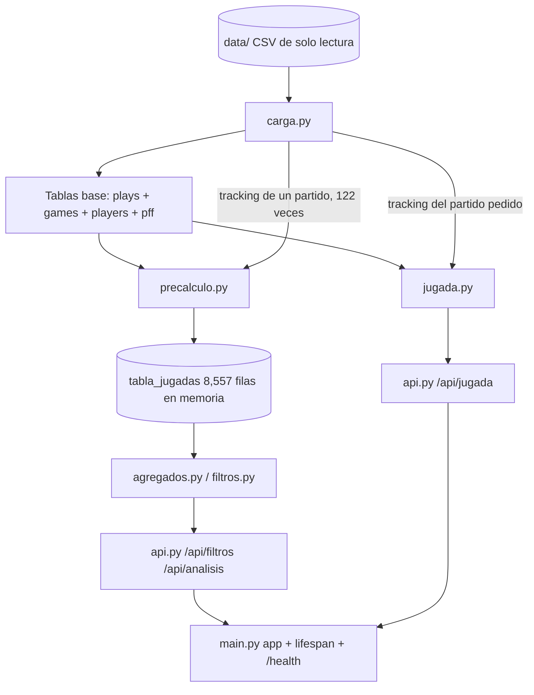
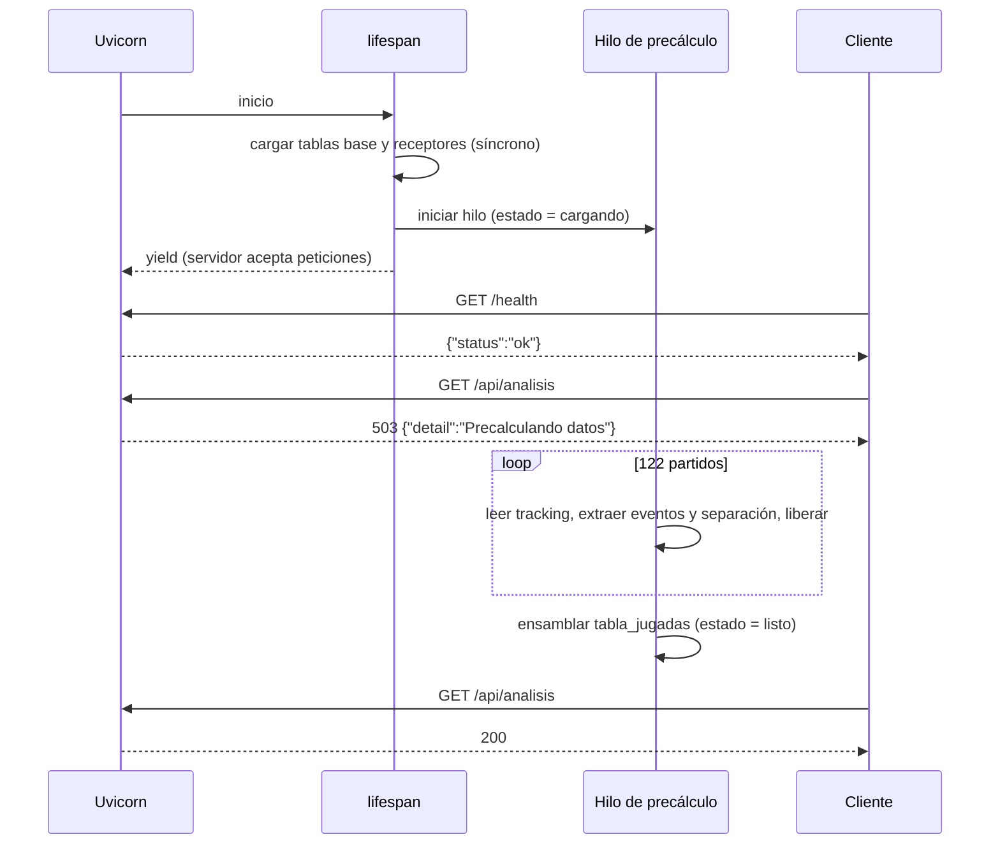

# Design Document

## Overview

El motor de datos es un paquete Python dentro de `backend/` que, al arrancar, convierte los CSV de `data/nfl-big-data-bowl-regional-event-data/data/` en **una tabla por jugada** (8,557 filas) y la guarda en memoria. `GET /api/analisis` y `GET /api/filtros` se responden filtrando y agregando esa tabla. `GET /api/jugada/{game_id}/{play_id}` lee bajo demanda solo el tracking del partido pedido. Nada se escribe a disco.

Decisiones principales:

| # | Decisión | Motivo |
|---|---|---|
| D1 | Precálculo único por partido (122 archivos, uno por uno) con `usecols` y dtypes reducidos. Solo se conserva el resumen por jugada. | Evita cargar los 8,314,178 registros (~818 MB) a la vez (Req. 1.2, 1.3). |
| D2 | Casi todo se calcula sin tracking: éxito, rango, presión, play action, cobertura y **receptor objetivo** salen de `plays`, `pffScoutingData`, `players` y `games`. El tracking solo aporta cuadros de snap/pase, separación y velocidades. | Reduce el trabajo por archivo a eventos y un cuadro por jugada. |
| D3 | Las tablas base se cargan de forma síncrona en el `lifespan` (segundos). El tracking se procesa en un hilo de fondo. `GET /health` y `GET /api/filtros` responden de inmediato. | Mantiene `/health` vivo durante el precálculo (Req. 1.7, 11.2). |
| D4 | Mientras el precálculo no termina, `GET /api/analisis` responde 503 con `Retry-After`. Ya está en el contrato (ver Decisiones cerradas, P1). | El contrato hoy no define un estado de carga. |
| D5 | El éxito se calcula con aritmética entera (`5*pre >= 2*ytg`) y no con `0.4 * ytg`. | Evita errores de punto flotante en el umbral. |
| D6 | Los cálculos viven en `backend/motor/` y no importan FastAPI. Las rutas están en `backend/api.py`. | Permite probar sin servidor (Req. 10.3). |
| D7 | Pruebas de propiedades con pytest + `numpy.random.default_rng(semilla)`; sin librerías nuevas. | Stack fijo. |

Fuera de alcance: dashboard, IA/Bedrock, jugadas de carrera, datos externos.

## Architecture



### Flujo de arranque



Si falta un archivo de `data/` (Req. 1.7) el motor pasa a `error`, registra el nombre del archivo con `logging` y los endpoints `/api/*` que dependen de datos responden 503 con el detalle. `GET /health` sigue respondiendo `{"status": "ok"}`. Si falta un solo tracking también se pasa a `error`, porque omitir un partido convertiría sus jugadas en `sin_snap` sin avisar.

Se asume un solo proceso de Uvicorn. Con varios workers cada uno repetiría el precálculo (la memoria por proceso es de decenas de MB).

### Medición del tiempo de arranque (criterio a verificar)

El motor registra con `time.perf_counter()` y `logging`: duración de la carga base, duración por partido y total del precálculo. La verificación consiste en ejecutar `construir_motor()` sobre los datos reales y anotar la cifra en el `README.md`. No se fija un umbral hasta medir; la referencia de trabajo es que el precálculo termine en menos de 60 s en el equipo de desarrollo. Si lo supera, la optimización a evaluar (no asumida) es procesar los partidos con `ThreadPoolExecutor`, solo si la medición muestra ganancia.

### Servir `dashboard/dist`

Ver Decisiones cerradas, P2.

## Components and Interfaces

### Estructura de archivos

```
backend/
  main.py            app, lifespan, GET /health, include_router y StaticFiles de dashboard/dist si existe
  api.py             APIRouter(prefix="/api"), dependencias y validación de parámetros
  esquemas.py        modelos Pydantic con las llaves exactas de contrato-api.md
  motor/
    __init__.py
    config.py        rutas, constantes (FPS, campo, rangos, eventos)
    carga.py         lectura de CSV (base y tracking de un partido)
    normalizacion.py normalizar por playDirection
    exito.py         rango de distancia, éxito, resumen de tasa
    receptor.py      parser de playDescription y resolución del receptor
    bolsillo.py      cuadros de snap/pase, categoría y tiempo
    separacion.py    separación y velocidades en el cuadro de pass_forward
    precalculo.py    tabla por jugada, procesar_partido, EstadoMotor, construir_motor
    filtros.py       catálogo de filtros y aplicación de filtros a la tabla
    agregados.py     bloques success_rate, coberturas, bolsillo, separacion
    jugada.py        detalle de jugada con caché pequeña
```

### Interfaces por módulo (todas con docstring y comentarios en español)

**`config.py`**
- `RAIZ = Path(__file__).resolve().parents[2]`; `DIR_DATOS = RAIZ / "data/nfl-big-data-bowl-regional-event-data/data"`.
- Constantes: `FPS = 10`, `LARGO = 120.0`, `ANCHO = 53.3`, `RANGOS_DISTANCIA = {"corta": (1, 3), "media": (4, 7), "larga": (8, None)}`, `RESULTADOS_PASE = ("C", "I", "S", "R", "IN")`, `PASE_CON_BALON = ("C", "I", "IN")`.
- Eventos: `SNAP = ("ball_snap", "autoevent_ballsnap")` y `PASE = ("pass_forward", "autoevent_passforward")`, cada tupla en orden primario, respaldo.

**`carga.py`**
- `leer_tablas_base(dir_datos) -> TablasBase` (`games`, `plays`, `players`, `pff`). Si falta un archivo lanza `ArchivoFaltante(nombre)`.
- `listar_partidos(dir_datos) -> list[int]`: `gameId` de los `tracking_*.csv`; contrasta con `games.gameId`.
- `leer_tracking_partido(game_id, dir_datos, columnas) -> DataFrame`: `usecols` y dtypes reducidos.
- Columnas leídas en el precálculo: `playId` (int32), `nflId` (float32), `frameId` (int16), `x`, `y` (float64), `s` (float32), `event` y `playDirection` (category). `gameId` sale del nombre del archivo. En el detalle de jugada se agregan `jerseyNumber`, `team`, `o` y `dir`.

**`normalizacion.py`**
- `normalizar_tracking(df) -> DataFrame`: aplica la geometría según `playDirection` por fila. "left": `x=120-x`, `y=53.3-y`, `o` y `dir` con `(ang+180)%360`. "right": sin cambios salvo `% 360`. Conserva filas fuera del campo y los nulos de `o`/`dir` del balón. Si `playDirection` es nulo, excluye esas filas y las devuelve en un segundo valor `jugadas_sin_direccion` que el llamador registra con `logging` (Req. 2.7). Devuelve una copia; no modifica la entrada.

**`exito.py`**
- `rango_distancia(yardas_por_avanzar: Series) -> Series` (categorías `corta|media|larga`; nulo si `yardsToGo < 1`).
- `es_exitosa(down, yardas_por_avanzar, pre_penalty, resultado_pase) -> Series[bool]`: `down==1: 5*pre >= 2*ytg`; `down==2: 5*pre >= 3*ytg`; `down in (3,4): pre >= ytg`; `IN` siempre `False`. Para `down` fuera de 1-4 devuelve `False` y el llamador usa `down_valido`.
- `resumen_tasa(exitosa: Series) -> dict` → `{"n","exitosas","tasa"}`; con `n == 0` devuelve `tasa 0.0` sin dividir.

**`receptor.py`**
- `RE_RECEPTOR`: la regex validada `\bpass\b[^()]*?\b(?:to|intended for)\s+([A-Z][A-Za-z]*\.(?:[A-Z]\.)?\s?[A-Z][A-Za-z'\-]+)`. No se modifica (reproduce los 7,240 de 7,562).
- `extraer_nombre_receptor(descripcion) -> str | None`: primer match de `re.search`.
- `partir_nombre(nombre_abreviado) -> (inicial, apellido)`: inicial = primera letra; apellido = texto tras el último punto, normalizado (minúsculas, solo letras).
- `apellido_oficial(display_name) -> (inicial, apellido)`: primer carácter y último token que no sea sufijo (`jr`, `sr`, `ii`, `iii`, `iv`, `v`), normalizado.
- `resolver_receptores(plays, rutas) -> Series[nfl_id | NaN]`: para cada jugada C/I/IN, candidatos = jugadores `Pass Route` de esa jugada (unidos a `players` por `nflId`). Coincidencia por apellido; si hay más de un candidato, se desempata por inicial; si queda exactamente uno, se asigna. Cero o más de uno → `NaN` (cuenta como `n_sin_receptor_identificado`). Implementación vectorizada con `merge` y `groupby`.

**`bolsillo.py`**
- `primer_cuadro_evento(eventos, nombres) -> Series`: mínimo `frameId` por `playId` de los eventos listados (Req. 5.11).
- `elegir_cuadro(primario, respaldo) -> (cuadro, usa_respaldo)`: toma el primario y usa el respaldo solo donde falta (Req. 5.2).
- `categoria_bolsillo(resultado_pase, snap, pase) -> Series`: `sin_snap` si no hay snap; si hay snap y `passResult` es C/I/IN con cuadro de pase, `con_pase`; en cualquier otro caso `sin_pase` (S, R y C/I/IN sin pase).
- `tiempo_bolsillo(snap, pase, categoria) -> Series`: `(pase - snap) * 0.1` solo para `con_pase`; nulo en el resto.
- `presion_pff(pff) -> Series[bool] por (gameId, playId)`: algún valor `pff_hit`, `pff_hurry` o `pff_sack` igual a 1; los nulos cuentan como 0.

**`separacion.py`**
- `separacion_en_cuadro(jugadores_cuadro, receptor_id, ids_cobertura) -> (sep, vel_rec, vel_def)`: distancia euclidiana mínima del receptor a los defensores `Coverage` y velocidades `s` de ambos en ese cuadro. Versión vectorizada por partido: `separaciones_partido(trk_pase, receptores, cobertura)`, con `merge` receptor × defensores y `groupby(...).idxmin()`.

**`precalculo.py`**
- `construir_tabla_base(tablas) -> DataFrame`: columnas que no requieren tracking (sección Data Models).
- `procesar_partido(game_id, tabla_base_partido, tablas, dir_datos) -> DataFrame`: lee el tracking, extrae cuadros de snap/pase y la separación, libera el DataFrame y devuelve solo las columnas de tracking por jugada.
- `construir_tabla_jugadas(tablas, dir_datos, progreso=None) -> DataFrame`: base + resultados de los 122 partidos.
- `EstadoMotor`: dataclass con `estado` (`cargando|listo|error`), `mensaje`, `tablas`, `tabla_jugadas`, `catalogo`, `tiempos`.
- `construir_motor(dir_datos=DIR_DATOS) -> EstadoMotor`: ejecuta todo de forma síncrona (usado por las pruebas y por el hilo).
- `iniciar_motor_en_segundo_plano(app) -> None`: llamada por el `lifespan`.

**`filtros.py`**
- `construir_catalogo(tablas) -> dict`: valores únicos reales (`equipos`, `semanas`, `downs`, `tipos_cobertura`, `coberturas`, `formaciones` sin nulos) más `rangos_distancia` fijos.
- `filtrar_jugadas(tabla, ofensiva, defensiva, semana, down, distancia) -> DataFrame`: máscara con todos los filtros enviados. Filtrar por `down` o `distancia` deja fuera las jugadas de `down 0`.

**`agregados.py`**
- `bloque_success_rate(df)`, `bloque_coberturas(df)`, `bloque_bolsillo(df)`, `bloque_separacion(df)` y `analizar(tabla, filtros) -> dict` con la forma de `contrato-api.md`.

**`jugada.py`**
- `detalle_jugada(estado, game_id, play_id) -> dict | None` (`None` si no existe).
- `tracking_partido_normalizado(game_id)`: `functools.lru_cache(maxsize=4)`. Cada entrada pesa pocos MB. Es una caché solo en memoria. Los DataFrames cacheados no se modifican.

**`api.py`**
- `GET /api/filtros`, `GET /api/analisis`, `GET /api/jugada/{game_id}/{play_id}`. Los endpoints son `def` síncronos (pandas es CPU; FastAPI los ejecuta en su pool de hilos).
- Dependencia `obtener_estado(request)` lee `request.app.state.motor`. `GET /api/filtros` y `GET /api/jugada` solo requieren las tablas base; `GET /api/analisis` requiere `estado == "listo"`.

### Esquemas Pydantic (`esquemas.py`)

Un modelo por objeto del contrato, con los mismos nombres de llave: `RangoDistancia`, `FiltrosRespuesta`, `FiltrosAplicados`, `Tasa`, `TasaDownDistancia`, `GlobalYPorDownDistancia`, `ResultadoPase` (campos `C`, `I`, `S`, `R`, `IN`), `GrupoCobertura`, `GrupoBolsillo`, `Bolsillo`, `GrupoSeparacion`, `Separacion`, `AnalisisRespuesta`, `Evento`, `ReceptorObjetivo`, `JugadorFrame`, `Frame`, `JugadaRespuesta`. Los endpoints usan `response_model=` para que la salida tenga exactamente esas llaves (los valores nulos del contrato se emiten como `null`). Todos los `float` pasan por una función que convierte `NaN` a `None` antes de serializar.

## Data Models

### Tabla por jugada (`tabla_jugadas`, 8,557 filas)

Una fila por `gameId + playId`. Columnas y origen:

| Columna | Tipo | Origen |
|---|---|---|
| `game_id`, `play_id` | int | `plays.gameId`, `plays.playId` |
| `semana` | int | `games.week` (unión por `gameId`) |
| `ofensiva`, `defensiva` | str | `plays.possessionTeam`, `plays.defensiveTeam` |
| `down`, `yardas_por_avanzar` | int | `plays.down`, `plays.yardsToGo` |
| `formacion` | str (nulo permitido) | `plays.offenseFormation` (7 nulos, dato faltante) |
| `cobertura`, `tipo_cobertura` | str | `plays.pff_passCoverage`, `plays.pff_passCoverageType` |
| `play_action` | bool | `plays.pff_playAction == 1` (no el evento del tracking) |
| `resultado_pase` | str | `plays.passResult` |
| `yardas_sin_castigo` | int | `plays.prePenaltyPlayResult` |
| `rango_distancia` | categoría o nulo | `rango_distancia(yardsToGo)` |
| `down_valido` | bool | `down` entre 1 y 4 |
| `exitosa` | bool | `es_exitosa(...)`; `False` si `down_valido` es falso (no se usa) |
| `presion` | bool | `presion_pff(pff)` (nulos = 0) |
| `receptor_nfl_id` | float (NaN) | `resolver_receptores(plays, rutas)` |
| `cuadro_snap` | float (NaN) | tracking: `ball_snap` primer cuadro, respaldo `autoevent_ballsnap` |
| `cuadro_pase` | float (NaN) | tracking: `pass_forward` primer cuadro, respaldo `autoevent_passforward` |
| `usa_respaldo` | bool | snap tomado de respaldo, o pase de respaldo cuando `passResult` es C/I/IN |
| `categoria_bolsillo` | `con_pase` / `sin_pase` / `sin_snap` | `categoria_bolsillo(...)` |
| `tiempo_bolsillo_s` | float (NaN) | `(cuadro_pase - cuadro_snap) * 0.1` solo para `con_pase` |
| `separacion_yd` | float (NaN) | `separacion_en_cuadro` en `cuadro_pase`; solo C/I/IN |
| `vel_receptor`, `vel_defensor` | float (NaN) | `s` del receptor y del defensor más cercano en `cuadro_pase` |

Derivados a la vez de la columna anterior: `separacion_medida = separacion_yd.notna()`; una jugada C/I/IN con `separacion_medida` falso cuenta en `n_sin_receptor_identificado` (incluye las de receptor no identificado y las sin cuadro de pase, según Req. 6.4).

Verificaciones de la tabla a cargo de las pruebas de integración:

- 8,557 filas y llaves `(game_id, play_id)` sin duplicados.
- `con_pase + sin_pase + sin_snap = 7,541 + 992 + 24 = 8,557`; `sin_pase` = 542 S, 447 R y 3 C/I.
- 35 filas con `down == 0` (`down_valido` falso).
- Separación (verificado con pandas sobre `data/`): de 7,565 pases C/I/IN, 7,240 medidos y 325 en `n_sin_receptor_identificado` (322 sin receptor identificable en `playDescription` y 3 sin cuadro de pase).

### Estado del motor

`EstadoMotor` vive en `app.state.motor`. Las pruebas pueden asignar un `EstadoMotor` ya construido sin ejecutar el `lifespan`.

### Algoritmos de cada métrica

**Normalización.** Vectorizada con una máscara `izq = playDirection == "left"`. Las funciones son puras y no mutan la entrada.

**Success Rate.** Se calcula una vez por jugada en `construir_tabla_base`. Las agregaciones usan solo las filas con `down_valido`. `n_excluidas_down_0` es el número de filas filtradas con `down == 0`. `por_down_distancia` se arma con `groupby(["down","rango_distancia"])` y se omiten las combinaciones sin filas.

**Coberturas.** Sobre filas con `down_valido`: `groupby(["tipo_cobertura","down","rango_distancia"])` con `n`, `success_rate = mean(exitosa)`, `yardas_promedio = mean(yardas_sin_castigo)` y `resultado_pase` con `value_counts` reindexado a C, I, S, R, IN (ceros incluidos).

**Bolsillo.** Por partido:
1. Del tracking solo se conservan las filas con `event` en `SNAP` o `PASE`.
2. `primer_cuadro_evento` por `(playId, evento)`; `elegir_cuadro` combina manual y respaldo para snap y para pase.
3. `categoria_bolsillo` usa `passResult`, no la presencia del evento (Req. 9.6).
4. `bloque_bolsillo` calcula: `n_con_pase`, `n_sin_pase`, `n_sin_snap` sobre las jugadas filtradas (`n_jugadas` incluye `down 0`); `n_con_respaldo_autoevent = sum(usa_respaldo)`; y `por_grupo` con `groupby(["play_action","presion"])` sobre las jugadas `con_pase`, con promedio y mediana del tiempo y `success_rate` sobre las jugadas del grupo con `down_valido`. Los grupos vacíos se omiten.

**Separación.** Por partido, para jugadas C/I/IN con `cuadro_pase`:
1. `merge` del tracking con `(playId, cuadro_pase)` para quedarse con ~23 filas por jugada.
2. Normalizar solo esas filas (la distancia no cambia con la normalización, pero se aplica para mantener un único origen de coordenadas).
3. `merge` receptor (`nflId == receptor_nfl_id`) × defensores (`nflId` con `pff_role == "Coverage"` de esa jugada), distancia euclidiana y `idxmin` por `playId`. De esa fila salen `separacion_yd`, `vel_receptor` y `vel_defensor`.
4. `bloque_separacion` agrupa por `resultado_pase` (C, I, IN) sobre las jugadas con `separacion_medida`. `n_sin_receptor_identificado` cuenta las C/I/IN sin medida; `momento = "pass_forward"`.

**Detalle de jugada.** (1) Ubicar la fila en `plays`; si no existe devuelve `None`. (2) Leer y normalizar el tracking del partido (caché) y filtrar por `playId`. (3) Unir `players.displayName` y `pff_role` por `nflId`. (4) `lado`: `team == possessionTeam` → `ofensiva`; `team == defensiveTeam` → `defensiva`; `team == "football"` → `balon` con `nfl_id`, `nombre`, `dorsal`, `rol`, `o` y `dir` nulos. (5) `eventos`: primer cuadro de cada tipo de evento, ordenado por `frame_id`. (6) `receptor_objetivo` con `receptor_nfl_id` de la tabla de receptores y la separación medida con `separacion_en_cuadro` en el cuadro de `pass_forward`; `null` si no hay pase o receptor. (7) `frames` agrupa por `frameId`; `s` en yd/s tal como viene en el dataset.

Esta función no depende del precálculo: usa las tablas base y `resolver_receptores`, por lo que responde mientras el tracking completo aún se procesa.

## Correctness Properties

*A property is a characteristic or behavior that should hold true across all valid executions of a system-essentially, a formal statement about what the system should do. Properties serve as the bridge between human-readable specifications and machine-verifiable correctness guarantees.*

### Property 1: Normalización según playDirection

*For any* conjunto de filas con `x`, `y`, `o` y `dir` aleatorios (incluidos valores fuera del campo y ángulos iguales a 360) y cualquier `playDirection`, la salida de `normalizar_tracking` SHALL cumplir: en filas "left", `x' = 120 - x`, `y' = 53.3 - y`, `o' = (o+180) % 360` y `dir' = (dir+180) % 360`; en filas "right", `x' = x`, `y' = y`, `o' = o % 360` y `dir' = dir % 360`; y todo `o'` y `dir'` no nulo está en [0, 360).

**Validates: Requirements 2.1, 2.2, 2.3, 2.4**

### Property 2: Conservación de filas y nulos del balón

*For any* tabla de tracking con filas de balón (`o` y `dir` nulos) y filas fuera del campo, `normalizar_tracking` SHALL devolver el mismo número de filas con `playDirection` presente, y los nulos de `o` y `dir` SHALL seguir nulos.

**Validates: Requirements 2.5, 2.6**

### Property 3: Involución de la normalización

*For any* jugada "left", aplicar `normalizar_tracking` dos veces SHALL devolver `x` y `y` originales (con tolerancia numérica) y `o` y `dir` iguales al original módulo 360.

**Validates: Requirements 2.8**

### Property 4: Clasificación de éxito frente a un oráculo independiente

*For any* combinación aleatoria de `down` en 1-4, `yardsToGo` ≥ 1, `prePenaltyPlayResult` y `passResult`, `es_exitosa` SHALL coincidir con el oráculo escrito con fracciones (`Fraction(2,5)`, `Fraction(3,5)`, 1) y SHALL ser falso cuando `passResult` es "IN".

**Validates: Requirements 3.1, 3.2, 3.3, 3.4, 3.5**

### Property 5: Rango de distancia es una partición

*For any* `yardsToGo` ≥ 1, `rango_distancia` SHALL asignar exactamente un rango: `corta` si está entre 1 y 3, `media` entre 4 y 7, `larga` si es 8 o más.

**Validates: Requirements 3.7**

### Property 6: Invariantes del resumen de Success Rate

*For any* conjunto de jugadas aleatorio (con `down 0` incluido), el bloque `success_rate` SHALL cumplir en el global y en cada combinación `down`/`distancia`: `exitosas <= n`, `tasa == exitosas / n` y `0 <= tasa <= 1`; las combinaciones sin jugadas SHALL estar ausentes; el global SHALL excluir las jugadas de `down 0` y `n_excluidas_down_0` SHALL contarlas.

**Validates: Requirements 3.6, 3.8, 3.9, 3.10, 7.6, 9.5**

### Property 7: Conservación en el bloque de coberturas

*For any* conjunto de jugadas aleatorio, en cada grupo de `coberturas` la suma de `resultado_pase` (C, I, S, R, IN) SHALL ser igual a `n`; la suma de los `n` de todos los grupos SHALL ser igual al número de jugadas con `down` entre 1 y 4; y `yardas_promedio` SHALL ser igual al promedio de `yardas_sin_castigo` del grupo.

**Validates: Requirements 4.1, 4.3, 4.4, 4.5**

### Property 8: Selección del primer cuadro con respaldo

*For any* tabla de eventos aleatoria (eventos manuales y automáticos, repetidos en varios cuadros, jugadas sin evento), el cuadro de snap (y el de pase) SHALL ser el mínimo `frameId` del evento manual si existe, y el del evento automático en otro caso; `usa_respaldo` SHALL ser verdadero solo cuando falta el manual y existe el automático; sin ninguno el cuadro SHALL ser nulo.

**Validates: Requirements 5.2, 5.3, 5.11, 6.1**

### Property 9: Partición de jugadas del bolsillo

*For any* tabla de jugadas aleatoria y cualquier combinación de filtros, `n_con_pase + n_sin_pase + n_sin_snap` SHALL ser igual a `n_jugadas`; las jugadas sin snap SHALL contarse solo en `n_sin_snap`; las jugadas S o R con snap SHALL contarse solo en `n_sin_pase` aunque tengan evento de pase; y una jugada `con_pase` SHALL tener `passResult` en C, I o IN, snap y pase.

**Validates: Requirements 5.4, 5.5, 5.6, 5.7, 7.10, 9.6**

### Property 10: Fórmula del tiempo de bolsillo

*For any* par de cuadros de snap y pase enteros con `pase >= snap` en una jugada `con_pase`, `tiempo_bolsillo` SHALL ser igual a `(pase - snap) * 0.1` y SHALL ser mayor o igual a 0; las jugadas que no son `con_pase` SHALL tener tiempo nulo.

**Validates: Requirements 5.1, 5.12**

### Property 11: Presión PFF

*For any* tabla `pffScoutingData` aleatoria con nulos en `pff_hit`, `pff_hurry` y `pff_sack`, `presion_pff` SHALL ser verdadera para una jugada si y solo si algún jugador tiene al menos uno de esos tres campos igual a 1; los nulos SHALL contarse como 0.

**Validates: Requirements 5.8, 9.3**

### Property 12: Resolución del receptor objetivo

*For any* roster aleatorio de jugadores `Pass Route` y cualquier descripción generada con plantilla ("... pass short right to I.Apellido ..." o "intended for ..."), `resolver_receptores` SHALL devolver el `nflId` del único jugador cuyo apellido coincide (desempatando por inicial) y SHALL devolver nulo cuando no hay coincidencia o la coincidencia es ambigua tras el desempate.

**Validates: Requirements 6.2, 6.4**

### Property 13: Separación igual a la búsqueda por fuerza bruta

*For any* cuadro aleatorio con un receptor y defensores `Coverage`, `separacion_en_cuadro` SHALL ser igual al mínimo de las distancias euclidianas calculadas con un bucle de referencia, SHALL ser mayor o igual a 0, las velocidades devueltas SHALL ser las del receptor y las del defensor que alcanza el mínimo, y la separación SHALL ser igual antes y después de normalizar las coordenadas.

**Validates: Requirements 6.3, 6.6, 6.8**

### Property 14: Los filtros equivalen a analizar el subconjunto

*For any* combinación de `ofensiva`, `defensiva`, `semana`, `down` y `distancia` sobre una tabla aleatoria, `analizar` SHALL producir el mismo resultado que analizar la tabla pre-filtrada con un filtrado independiente escrito con bucles; `n_jugadas` SHALL ser menor o igual al de cualquier subconjunto de filtros; y repetir la llamada SHALL dar el mismo resultado. Si el subconjunto es vacío SHALL devolver `n_jugadas = 0` y listas vacías sin error.

**Validates: Requirements 7.4, 7.7**

### Property 15: Integridad del detalle de jugada

*For any* jugada de una muestra aleatoria de jugadas reales (semilla fija), `detalle_jugada` SHALL devolver `frames_por_segundo = 10`; para cada jugador, `nombre` y `rol` SHALL coincidir con la unión por `nflId` de `players` y `pffScoutingData`; el balón SHALL tener `lado = "balon"` y `nfl_id`, `nombre`, `dorsal`, `rol`, `o` y `dir` nulos; `x`, `y`, `o` y `dir` SHALL ser iguales a `normalizar_tracking`; y `eventos` SHALL tener un solo registro por tipo con su `frame_id` mínimo.

**Validates: Requirements 8.2, 8.3, 8.4, 8.5, 8.6, 9.1**

## Error Handling

| Situación | Respuesta |
|---|---|
| Falta un CSV de `data/` | Se registra el nombre del archivo con `logging.error`; `estado = error`; `/api/*` con datos responde 503 `{"detail": "Motor de datos no disponible: falta <archivo>"}`; `/health` responde ok. |
| Precálculo en curso | `GET /api/analisis` → 503 `{"detail": "Precalculando datos"}` con cabecera `Retry-After: 5`. `GET /api/filtros` y `GET /api/jugada` responden con normalidad una vez cargadas las tablas base. |
| `down` no numérico o fuera de 1-4 | 422 del formato FastAPI (`Query(ge=1, le=4)`). |
| `distancia` fuera de `corta|media|larga` | 422 (`Literal`). |
| `semana`, `ofensiva` o `defensiva` fuera del catálogo | 422 con `RequestValidationError` (`loc: ["query", "<campo>"]`), con la misma forma `{"detail": [...]}` de FastAPI. |
| Ningún dato cumple los filtros | 200 con `n_jugadas = 0`, `n_excluidas_down_0 = 0`, listas vacías, `global` con `n = 0`, `exitosas = 0`, `tasa = 0.0` y contadores de bolsillo y separación en 0. Sin división entre cero. |
| `game_id` o `play_id` no enteros | 422 automático de FastAPI. |
| Jugada inexistente | 404 `{"detail": "Jugada no encontrada"}`. |
| Jugada sin snap | 200; `eventos` sin snap. |
| Sin pase o receptor no identificado | 200 con `receptor_objetivo = null`. |
| `playDirection` nulo | Las filas se excluyen de la normalización y se registran `gameId` y `playId` con `logging.warning` (no se asume dirección). |
| `NaN` en una respuesta | Se convierte a `null` antes de serializar. |

## Testing Strategy

Las pruebas son opcionales según `rules.md`, pero el diseño las deja definidas. Usan solo `pytest 8.3.5` y `httpx 0.28.1` (`TestClient`).

**Aplicabilidad de las propiedades.** El motor tiene funciones puras con entradas amplias (normalización, éxito, selección de cuadros, presión, receptor, separación, filtros). Son aptas para pruebas por propiedades. La capa HTTP, la lectura de archivos y el arranque se prueban con ejemplos.

**Propiedades sin librerías nuevas.** No se usa Hypothesis ni otra librería. Cada propiedad es una prueba `pytest` que genera sus entradas con `numpy.random.default_rng(semilla)`, con semilla fija y **al menos 100 iteraciones** (`@pytest.mark.parametrize("semilla", range(100))` o un bucle interno de 100 casos). Los generadores sintéticos construyen DataFrames pequeños con las mismas columnas de las tablas reales e incluyen casos límite: `down 0`, ángulos 360, filas fuera del campo, jugadas sin snap, eventos repetidos, nulos de PFF, descripciones sin receptor y apellidos repetidos. Cada prueba lleva el comentario `# Feature: 01-motor-datos, Property N: <título>` y valida una sola propiedad.

**Pruebas unitarias y de ejemplo.**
- Parser de receptor con una lista corta de descripciones reales y casos de `intended for`.
- `GET /health` responde `{"status": "ok"}` también con `estado = error` (ruta de datos inexistente).
- Rutas bajo `/api` y esquema de llaves de las tres respuestas (conjunto exacto de llaves contra el contrato).
- 422 en `down=0`, `down=abc`, `semana=99`, `distancia=xyz`, `game_id=abc`; 404 en jugada inexistente; 503 con `EstadoMotor` en `cargando`.
- Jugada sin snap conocida (`2021091200` / `4367`): 200 y `eventos` sin snap. Jugada con sack: `receptor_objetivo` nulo.
- `leer_tracking_partido` se llama una vez, con un solo `gameId`, por petición de `GET /api/jugada` (espía).
- Construir el motor no crea archivos nuevos (comparación del árbol del proyecto).

**Pruebas de integración con datos reales** (un `fixture` con `scope="session"` ejecuta `construir_motor()` una vez y registra su duración; las pruebas asignan el estado a `app.state.motor` y usan `TestClient(app)` sin ejecutar el `lifespan`):
- 8,557 jugadas sin duplicados y sin filtros; 35 con `down 0` (`n_excluidas_down_0 = 35`).
- Bolsillo sin filtros: 7,541 `con_pase`, 992 `sin_pase` (542 S, 447 R, 3 C/I) y 24 `sin_snap`.
- 7,240 jugadas con separación medida.
- `tiempo_bolsillo_s >= 0` en todas las jugadas `con_pase`. Si alguna incumple, el hallazgo se reporta al usuario antes de decidir cómo tratarla (Req. 5.12).
- Velocidad máxima de jugadores 11.18 yd/s (sin balón) con el tracking completo, usando una lectura auxiliar de solo la columna `s`.
- Valores de `GET /api/filtros` iguales a `unique()` de los CSV.
- Tiempo de arranque: el `fixture` imprime la duración total del precálculo; se anota en el `README.md`.

**Reproducibilidad.** Cada cifra del `README.md` cita la función del motor que la produce y su `n`.

## Decisiones cerradas (antes puntos abiertos)

**P1. Respuesta durante la carga.** Decidido: `GET /api/analisis` responde 503 `{"detail": "Precalculando datos"}` con `Retry-After: 5` mientras el precálculo no termina. Ya está en `contrato-api.md` (commit `2ba4bb5` en `main`); el frontend muestra "cargando" y reintenta.

**P2. Servir `dashboard/dist`.** Decidido: en `main.py`, después de `/health` y del router `/api`, se monta `StaticFiles(directory="dashboard/dist", html=True)` en `/` solo si `dashboard/dist` existe. Se registra antes un manejador de 404 en JSON para rutas `/api/...` inexistentes, para que no las capture el montaje estático.

**P3. Validación de equipos.** Decidido: 422 si `ofensiva` o `defensiva` no está en `equipos` (el contrato lo incluye en parámetros inválidos).

**P4. Grupos de bolsillo.** Decidido: `por_grupo` usa solo jugadas `con_pase`. Su `success_rate` se calcula sobre las de `down` 1-4 del grupo.

**P5. Conteo de `n_con_respaldo_autoevent`.** Decidido: jugadas `con_pase` cuyo snap o pase salió de un evento automático.

**P6. Campo `equipo` del balón.** Decidido: `"football"`, como en el dataset. Ya está en `contrato-api.md`.

**P7. Tiempo de arranque.** Sigue como criterio a verificar: se mide con `construir_motor()` sobre los datos reales y se anota en el `README.md` antes de fijar un umbral.
